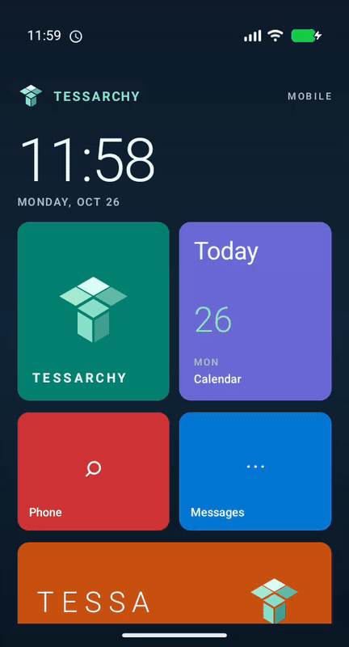

# Tessarchy Android Edition

TAE is the Android-based edition of Tessarchy. The first milestone is a Tessa-inspired
home launcher with a Windows Phone-style live-tile layout. Android remains responsible
for device hardware, telephony, app processes and system services.

## Current prototype

- Android app that can be selected as the device's Home app
- Tessarchy navy and mint framing with flat, Metro-inspired colored tiles
- Live clock and date
- Phone, messages, calendar, photos and music intent tiles
- Searchable app drawer built from installed launcher activities
- Android 12 minimum SDK, Android 17 compile and target SDK

## Emulator demo

The recording shows the Metro-style home tiles, tapping Tessa, scrolling down, and
opening the Apps drawer:



Full-size stills and the source emulator recording are also in `artifacts/`.

The current concept art is in `assets/concepts/`.

See [the code audit and 20-item improvement roadmap](docs/audit-roadmap.md) for
the current findings and development queue.

## Build and run

Requirements: Android SDK Platform 37, Android Build Tools 36, Android Emulator,
and JDK 17. `mise.toml` pins the project-local Java version. Open this directory
in Android Studio and allow Gradle sync, or use the terminal commands below.
Create an Android 17 (API 37) phone AVD, then run the `app` configuration. To
check the minimum supported platform, also create an Android 12 (API 31) AVD.

From a terminal with Java, Android SDK and the Gradle wrapper available:

```sh
mise exec -- ./gradlew :app:assembleDebug
mise exec -- ./gradlew :app:installDebug
```

The local API 37 AVD is named `TAE_API_37`. To start it headless on a smaller
host, use software rendering and two virtual CPUs:

```sh
~/Android/Sdk/emulator/emulator -avd TAE_API_37 -no-window -no-audio \
  -no-boot-anim -cores 2 -gpu swiftshader_indirect
```

Its first boot takes several minutes while Android prepares the system image.
The checked-in project ignores the local SDK path and emulator data. Screenshots
from the first run are in `artifacts/`.

After installing, choose **Tessarchy** under Android's Default apps → Home app.
The emulator must be running for the install command. The ignored `local.properties`
file points Gradle at the local SDK under `~/Android/Sdk`.

## Project layout

- `app/src/main/` — Android launcher source, manifest and resources
- `app/src/test/` — local unit-test source set
- `assets/` — concept art and visual assets
- `docs/` — design and implementation notes

## Next development steps

1. Tune tile proportions and the app drawer for phone and tablet screens.
2. Replace placeholder glyphs with a consistent Tessarchy icon set.
3. Add editable tile arrangement and live data sources.
4. Bring up a full Tessarchy Android system image on Cuttlefish, then adapt it for
   the OnePlus 7 (`guacamoleb`).
